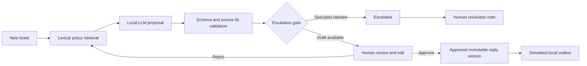

# Support Studio — Customer Support AI Agent

By [K Saurav Kiron](https://github.com/Saurav-Kiron).

A local AI-assisted support workspace that turns a fictional customer ticket into a policy-informed draft, routes sensitive requests to specialist review, and requires human approval before **simulated** delivery. It combines an LLM proposal with a deterministic Python workflow; the model cannot send messages or change accounts.

## Features

- Create, filter, and review persistent tickets in a responsive browser interface.
- Retrieve up to three policies using lexical token overlap, plus the mandatory review policy.
- Run local Qwen 2.5 through Ollama with a structured JSON output schema.
- Validate categories, priorities, lengths, and cited policy IDs; retry malformed proposals once.
- Escalate refund and selected security, legal, and data-deletion requests through deterministic rules.
- Edit and approve drafts, reject them for reanalysis, or record specialist resolution.
- Enforce approval on the server, including when someone calls the API directly.
- Detect stale/concurrent updates with revision numbers checked in SQLite transactions.
- Save the approved text exactly once to a local simulated outbox.
- Record each state transition and its audit event in the same database transaction.
- Run automated workflow tests and a separate real-model development evaluation.

**Scope:** single-user local portfolio prototype using fictional policies. No real email, helpdesk integration, refunds, identity verification, or account actions. It has no authentication, tenant isolation, or tamper-proof audit storage. Keep the server bound to localhost.

## Stack

Python 3.13 · FastAPI · Pydantic · SQLite · HTTPX · Ollama / Qwen 2.5 · HTML/CSS/JavaScript · pytest · GitHub Actions.

The workflow is implemented directly in Python. It does **not** use LangGraph, a vector database, or autonomous model tool calls. Retrieval uses word overlap, not embeddings. These are deliberate limits of this small implementation.

## Run on Windows

Install Python 3.13 and Ollama, then open PowerShell in the project folder:

```powershell
python -m venv .venv
.\.venv\Scripts\python.exe -m pip install -r requirements-dev.txt
ollama pull qwen2.5:1.5b
.\.venv\Scripts\python.exe -m uvicorn main:app --host 127.0.0.1 --port 8001
```

Keep Ollama running. Open **http://127.0.0.1:8001**. API documentation is at `/docs`. The first model request may be slow while the model loads. There are up to two model calls per analysis, each with a 180-second HTTP timeout.

Alternatively, double-click `setup.cmd` once and then `start.cmd`. Calling the virtual environment's Python directly avoids PowerShell activation-policy changes. On Linux/macOS replace the interpreter path with `.venv/bin/python`.

Port 8001 lets this project run beside [Evidence Desk](https://github.com/Saurav-Kiron/enterprise-knowledge-assistant) on port 8000.

## Try the complete workflow

1. Click **Use example**, then **Create ticket**.
2. Click **Analyze with local AI**.
3. Inspect the cited policies and every statement in the proposed reply.
4. Edit the reply and click **Approve edited reply**.
5. Click **Simulate delivery**. The outbox contains the exact approved text; nothing is sent externally.
6. Create a refund request. It must go to specialist review and cannot be approved for delivery through the normal draft path.
7. Restart the server. Tickets and their timelines persist.

An escalated ticket can be marked resolved with a note; that records a human decision, not an external action. Rejected drafts can be analyzed again. Approved drafts must be rejected before they can be changed.

## Architecture



State changes are constrained to:

| Current state | Allowed next states |
|---|---|
| new | review, escalated |
| review | approved, rejected |
| approved | sent, rejected |
| rejected | review, escalated |
| escalated | resolved |
| sent / resolved | terminal |

The browser supplies the ticket revision with every action. The server checks it inside `BEGIN IMMEDIATE`, changes the ticket, records the audit event, and commits. A stale operation returns HTTP 409. Model inference runs outside that transaction; the revision is rechecked after inference.

## Tests and evaluation

```powershell
.\.venv\Scripts\python.exe -m pytest tests -q
.\.venv\Scripts\python.exe evaluate.py
```

Workflow tests use a fake model and check actual server invariants: approval enforcement, exact approved text, duplicate delivery prevention, race conflicts, outage handling, persistence, and input validation. They do not measure LLM quality.

The evaluation script uses real Ollama on six synthetic development cases and writes `reports/evaluation.json`. It checks category and escalation only. It is not a held-out benchmark and does not establish draft correctness. See [verification notes](reports/VERIFICATION.md) for measured results and limitations.

## Configuration

| Environment variable | Default | Purpose |
|---|---|---|
| `OLLAMA_URL` | `http://127.0.0.1:11434` | Ollama server |
| `CHAT_MODEL` | `qwen2.5:1.5b` | Local generation model |
| `SUPPORT_DATA_DIR` | `data` beside source | SQLite storage directory |

Set variables before starting the server; `.env` files are not automatically loaded. The client disables proxy-environment discovery for Ollama requests. If you change `OLLAMA_URL` to a remote service, ticket content and retrieved policies will go to that service.

## API

`GET /tickets`, `POST /tickets`, `GET /tickets/{id}`; `POST /tickets/{id}/analyze`, `/approve`, `/reject`, `/simulate-send`, `/resolve`; `GET /policies`, `/health`.

Every action body contains `revision`. Approval also requires `reply`; rejection and specialist resolution require `note`. See `/docs` for the complete schemas.

## Important limits and next work

- Policy-ID validation checks provenance, not entailment. A draft can cite a real policy yet misunderstand it. Human review remains essential.
- Keyword-based retrieval and escalation rules miss paraphrases and can over-trigger. They are not a comprehensive security classifier.
- Prompts treat customer text as untrusted, but prompt-injection resistance is not guaranteed. The stronger boundary is that the model has no action-execution tools.
- A malicious local caller could approve their own draft: without authentication, the app does not establish reviewer identity.
- SQLite events can be changed by someone with database access. “Audit trail” does not mean immutable or compliance-certified.
- Tickets have no retention/deletion workflow in this version. Use fictional data. The queue displays the most recent 200 tickets.
- Dependencies are pinned at the top level; transitive dependencies are not fully locked.
- Next steps: authentication and roles, retention controls, a larger evaluation set, semantic retrieval, a durable job queue, rate limiting, and sandboxed helpdesk integration.

## Learn the implementation

Start with [the walkthrough](docs/PROJECT_WALKTHROUGH.md), then [the interview guide](docs/INTERVIEW_GUIDE.md). Describe this as an AI-assisted portfolio build and be ready to explain, modify, and test each part.
